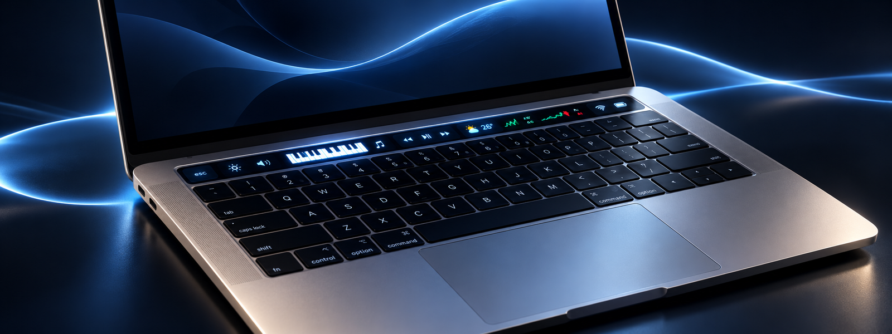
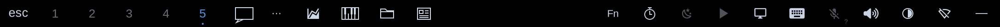
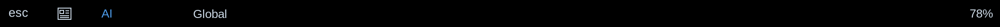
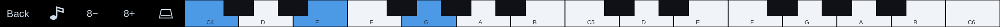

<div align="center">

# Omarchy T1 MacBook

### Give your Touch Bar a second act.

An experimental community project bringing a useful, customisable Touch Bar to the **2016 13-inch MacBook Pro** running **Omarchy**.

[Explore the features](#meet-your-touch-bar) · [See the previews](#a-closer-look) · [Installation guide](docs/INSTALL.md) · [What works today](docs/VALIDATION.md)

</div>



*Artist's impression: the illustration combines several Touch Bar modes for effect. The previews below show the software interface.*

> [!IMPORTANT]
> **Experimental: 0.1.0-rc1 has been tested on one MacBookPro13,2 / A1706.** Display and touch, core controls, piano, news, logout/login and a full shutdown/power-on have been confirmed on the reference laptop. Camera capture is unavailable; suspend/resume, live rollback, a fresh DKMS installation and independent reproduction remain unverified. Read the [release notes](docs/RELEASE.md) and [installation guide](docs/INSTALL.md) before trying it.

## Meet your Touch Bar

Your laptop already has a little screen above the keyboard. This project gives it more to do: switch workspaces, adjust your settings, keep an eye on the day — or, when the moment calls for it, play a very small piano.

| | At your fingertips |
| --- | --- |
| **The essentials** | Escape, Hyprland workspaces, function keys, brightness, keyboard light, volume, media and battery controls. |
| **A little focus** | A timer with 5, 10, 15 and 25-minute presets, pause and clear, plus blue overtime when time's up. |
| **Your daily dashboard** | Optional weather forecasts, news headlines, delayed market data, folder shortcuts and a ChatGPT app shortcut. |
| **A surprisingly small piano** | 25 keys, octave shifts, sustain and eight demos. Because of course your Touch Bar needed a piano. |

Optional pages are selected at installation and default off. News and markets depend on third-party services; weather uses shared Omarchy data where available or an explicitly configured location. See [features and data sources](docs/FEATURES.md).

## A closer look

These are **synthetic software renders**, not photographs of the physical panel. The hero above is an illustrative interpretation.

**Everyday controls** — workspaces and shortcuts alongside media and system controls.



**Headlines, without leaving your keyboard** — browse news by category and move through headlines.



**The tiny concert hall** — play notes yourself or choose a demo.



## What the project provides

- Basic firmware-rendered Touch Bar controls using the existing T1 iBridge driver lineage.
- A custom 2170 × 60 strip with Escape, Hyprland workspaces, F-keys, sliders, media controls, battery/power information and a timer.
- Configurable optional pages: folder shortcuts, piano, news, weather, markets and a ChatGPT desktop shortcut.
- A separate BCM43602 board-data installer with explicit 2.4 GHz or 5 GHz modes. **Both bands together aren't solved.**

The three installation components are `basic`, `desktop` and `wifi`. Installing one doesn't silently enable the others. The desktop component needs a working basic-driver fallback. Ordinary keyboard/trackpad support continues to use the kernel's `applespi`; this project doesn't replace it.

## Compatibility

| Item | Reference result |
| --- | --- |
| Model | MacBookPro13,2 / A1706 / 2016 13-inch T1 |
| Omarchy package | **4.0.6-1**, confirmed with Pacman; a stale source marker says 4.0.0.alpha |
| Kernel | **7.2.8-9-omarchy** |
| T1 USB | `05ac:8600`, normal firmware identity |
| Wi-Fi | BCM43602 `14e4:43ba`, subsystem `106b:0157`, firmware 7.35.177.61 |
| Previous custom implementation | Physical display/touch, Escape, workspaces, sliders and lock/unlock confirmed |
| Consolidated candidate | Builds/tests passed; existing-module installation and initial physical checks passed; logout/login and full shutdown/power-on confirmed |
| Camera | Capture unavailable in the reference session; only a media-controller node appears. Same UVC error persists in the confirmed full-power-on boot. |
| Pending | Other optional pages, sleep/resume, live rollback, fresh DKMS installation, portable Wi-Fi provisioning and independent clean install |

T2, Apple silicon, A1708 and other 2016/2017 models aren't supported by this candidate's hardware gate. A recovery-mode T1 needs firmware-startup diagnosis first. No Apple firmware is bundled.

The latest boot reached Touch Bar readiness after a transient desktop-bridge startup failure. A source correction delays socket publication until the compositor/session is ready; it passes four regression checks and has been installed and activated successfully. The owner has now confirmed logout/login and full shutdown/power-on; the latest boot reaches renderer readiness without the earlier hardware-reset retry. See [Validation](docs/VALIDATION.md).

## Build and inspect

On the reference Omarchy installation the relevant packages are `base-devel`, `pkgconf`, `cairo`, `libdrm`, `python`, `dkms` and **headers matching the running kernel** (`linux-omarchy-headers` there). Runtime controls use Omarchy's own commands, `brightnessctl` and `pactl` from `libpulse`. Piano additionally uses `pw-cat` from `pipewire-audio`; folder/news launching uses `xdg-utils` and folder lookup uses `xdg-user-dirs`. Retain Omarchy's normal Nerd Font for the symbols.

Run as your regular user:

```bash
make
make test
make modules
python3 tools/doctor.py
python3 tools/manage.py plan --component desktop --user "$USER"
```

`make modules` compiles locally without installing/loading modules. `make test-full` adds real local socket round trips. Restricted authoring environments may prohibit those sends; exit 77 means the socket check is unavailable, not passed. On a normal desktop, require the full test to pass before activation.

See [Installation](docs/INSTALL.md) for clean installations and [Migration](docs/MIGRATION.md) for an existing custom setup. **Don't run the old sequence of incremental update installers.**

## Installation model

File installation and activation are deliberately separate:

```bash
sudo python3 tools/manage.py install --component desktop --user "$USER"
sudo python3 tools/manage.py activate --component desktop
```

The first command installs files and private recovery records; it doesn't stop services, load modules or change connections. The second registers/builds the needed DKMS modules and starts the relevant services. Follow the prerequisites in the installation guide first. Existing files require a reviewed `--adopt-existing`; existing external DKMS providers require review or explicit `--reuse-modules`.

Installed offline recovery commands are `omarchy-t1-basic`, `omarchy-t1-desktop` and `omarchy-t1-wifi`, each accepting `status`, `recover`, `activate` or `uninstall`. The source checkout is needed for creating a new installation plan or upgrade, but not for recovery/removal.

## Important limits

- Camera capture is currently unavailable on the reference laptop. The same UVC issue appears in the earlier setup; its cause and recovery remain unresolved. See [Camera status](docs/CAMERA.md).
- Earlier tests found that returning from custom graphics to the original firmware controls can restore touch while leaving the strip dark. Save work, shut down fully and power on after restoring the original setup.
- Wi-Fi 2.4 GHz and 5 GHz use different tested board flags. Public-network joins and hibernation recovery still have unresolved failures. See [Wi-Fi](docs/WIFI.md).
- The core UI is local. News/markets use third-party internet services; weather uses existing shared Omarchy data where available, or an explicitly configured Open-Meteo location. Providers can be unavailable. Optional pages default off.
- This is a single-desktop-account setup. Select that account at installation; simultaneous multi-user graphical sessions aren't supported.

## Documentation and contribution

- [Installation, uninstall and interrupted-operation recovery](docs/INSTALL.md)
- [Migration of the reference custom setup](docs/MIGRATION.md)
- [Wi-Fi procedure and evidence boundaries](docs/WIFI.md)
- [Optional pages and data sources](docs/FEATURES.md)
- [Architecture and privilege boundaries](docs/ARCHITECTURE.md)
- [Validation and physical test checklist](docs/VALIDATION.md)
- [Credits](CREDITS.md) and [licence](LICENSE)

Run `python3 tools/doctor.py` for a small diagnostic report. It doesn't print SSIDs, MACs, serials, raw EFI data or journals. Review any additional logs before sharing them. Test results and narrowly scoped patches are welcome; broader model support needs physical evidence.
